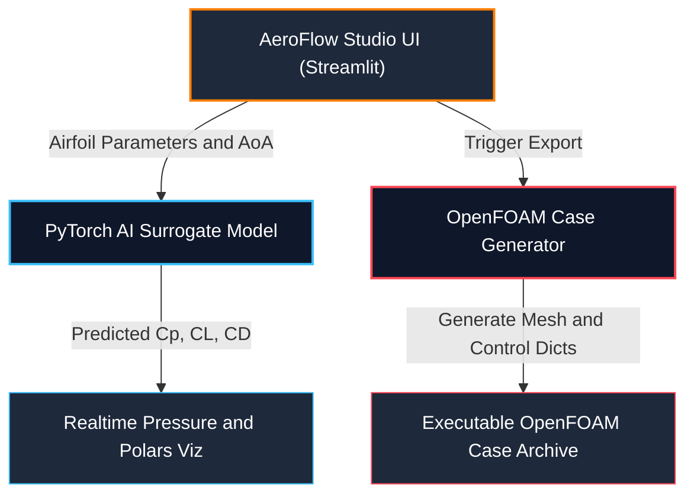

# ✈️ AeroFlow Studio: Real-Time Neural CFD & Aerodynamics Playground

**AeroFlow Studio** is an interactive, deep-learning-accelerated fluid dynamics engine designed to bridge the gap between rapid conceptual aerodynamic exploration and industrial-grade CFD validation.

By leveraging a custom **PyTorch Neural Surrogate Model**, AeroFlow Studio predicts 2D airfoil pressure distributions ($C_P$), Lift ($C_L$), and Drag ($C_D$) polars in **< 10 ms**—achieving over a **1,000× speedup** compared to standard steady RANS finite-volume solvers.

---

## 🧸 Explain Like I'm 5 (ELI5)

> **Imagine you are holding your hand out of a moving car window.**
> 
> If you tilt your hand up, the wind pushes it high into the sky (that's **Lift**!). If you tilt it too much, the wind pushes your hand backward really hard (that's **Drag**!).
> 
> Big engineering computers normally take a **really long time**—sometimes hours or days—to calculate how air pushes on an airplane wing.
> 
> **AeroFlow Studio** uses a super-smart **AI robot brain** that has learned what air does. When you change the shape of a wing, the AI tells you **instantly** how high it will fly and how fast the wind will blow around it! 
> 
> You can also:
> - 🎈 Squeeze water through narrow pipes to watch it zoom faster (like putting your thumb over a garden hose!).
> - 🎨 Draw custom shapes on the screen and watch wind particles bounce off them.
> - 📦 Package your wing design into a special file box with one click to send it to giant university supercomputers!

---

## 🌟 Key Features

### 🚀 1. Neural CFD Engine & Parametric NACA Generator (Tab 2)
* **Instant Inferences:** Real-time prediction of pressure profiles across custom or parametric NACA 4-digit geometries ($m, p, t$).
* **3D Wing Mesh Preview:** Live WebGL 3D wing surface extrusion powered by Plotly with adjustable wingspan.
* **Aerodynamic Polars:** Automated Angle of Attack sweeps ($\alpha \in [-5^\circ, 15^\circ]$) displaying $C_L$ vs. $\alpha$ and Drag Polars ($C_L$ vs. $C_D$).
* **Data Export:** Single-click CSV export for aerodynamic coefficients and pressure distributions.

### 📦 2. OpenFOAM Automated Case Exporter
* **Pre-Processing Automation:** One-click generation of fully configured, ready-to-run **OpenFOAM (`simpleFoam`)** CFD case packages (`.zip`).
* **Automated Boundary Calculations:** Automatically computes inflow velocity vector rotation ($U_x, U_y$) based on $\alpha$, generates `blockMeshDict`/geometry files, and attaches `forceCoeffs` function objects for numerical validation.

### 🧪 3. Venturi Tube & Internal Flow Mechanics (Tab 4)
* **Real-Time Internal Flow:** Interactive simulation of convergent-divergent nozzles demonstrating **Bernoulli's Principle** ($P_1 + \frac{1}{2}\rho v_1^2 = P_2 + \frac{1}{2}\rho v_2^2$) and **Conservation of Mass** ($A_1 v_1 = A_2 v_2$).
* **Live Manometer Gauges:** Dynamic 2D pipe cross-section featuring live manometer liquid tubes that visually react to static pressure drops at the throat.

### 🌊 4. Interactive Particle Collision Solver (Tab 3)
* **Canvas Barrier Drawing:** Real-time fluid particle streaming canvas allowing users to draw custom barriers, circular obstacles, or airfoils with live deflection physics.

---

## 🏗️ System Workflow & Architecture

🛠️ Industrial & Lab Software IntegrationAeroFlow Studio is designed to complement standard industrial CFD workflows used across European automotive and aerospace engineering sectors:ToolRole in WorkflowPyTorch (AeroFlow Studio)Conceptual design & instantaneous geometry optimization loopOpenFOAM / simpleFoamHigh-fidelity finite-volume validation for exported case packagesKitware ParaViewPost-processing, velocity streamline plotting, and flow cutplane visualizationXFLR5 / XFOILBaseline 2D panel method aerodynamic polar validation🚀 Quick Start & InstallationPrerequisitesPython 3.10 or higherGitLocal SetupClone the repository:Bashgit clone [https://github.com/YOUR_USERNAME/realtime-airfoil-cfd.git](https://github.com/YOUR_USERNAME/realtime-airfoil-cfd.git)
cd realtime-airfoil-cfd
Create and activate a virtual environment:Bash# Windows (PowerShell)
python -m venv venv
.\venv\Scripts\Activate.ps1

# Linux/macOS
python3 -m venv venv
source venv/bin/activate
Install dependencies:Bashpip install -r requirements.txt
Launch AeroFlow Studio:Bashstreamlit run app/app.py

📂 Project Directory Structurerealtime-airfoil-cfd/
├── app/
│   ├── app.py                # Main Streamlit UI & Interactive Dashboard
│   ├── aoa_visualizer.html   # Canvas Pitching Visualizer (Tab 1)
│   └── logo.svg              # Minimalist SVG Branding Logo
├── src/
│   ├── model.py              # PyTorch Neural Surrogate Architecture
│   ├── dataset_generator.py  # NACA 4-digit Parametric Point Generator
│   └── openfoam_generator.py # OpenFOAM Case Directory & Zip Compiler
├── models/
│   └── saved/
│       └── surrogate_model.pth # Trained PyTorch Model Weights
├── README.md                 # Project Documentation
└── requirements.txt          # Python Dependencies

📜 LicenseDistributed under the MIT License. See LICENSE for more information.
